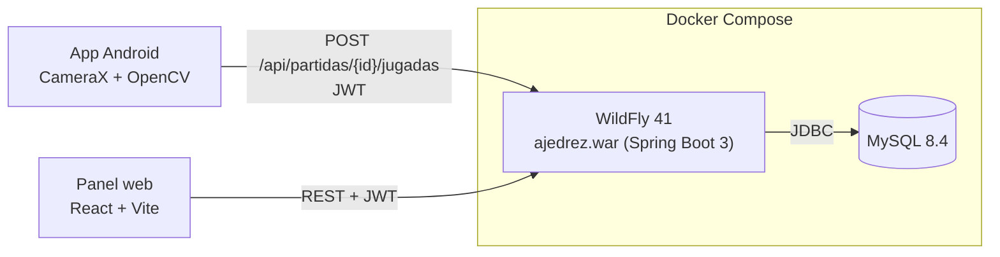
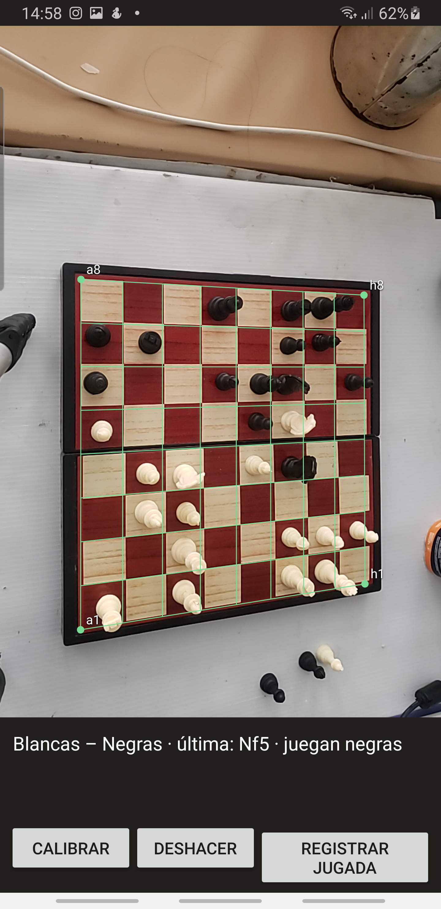
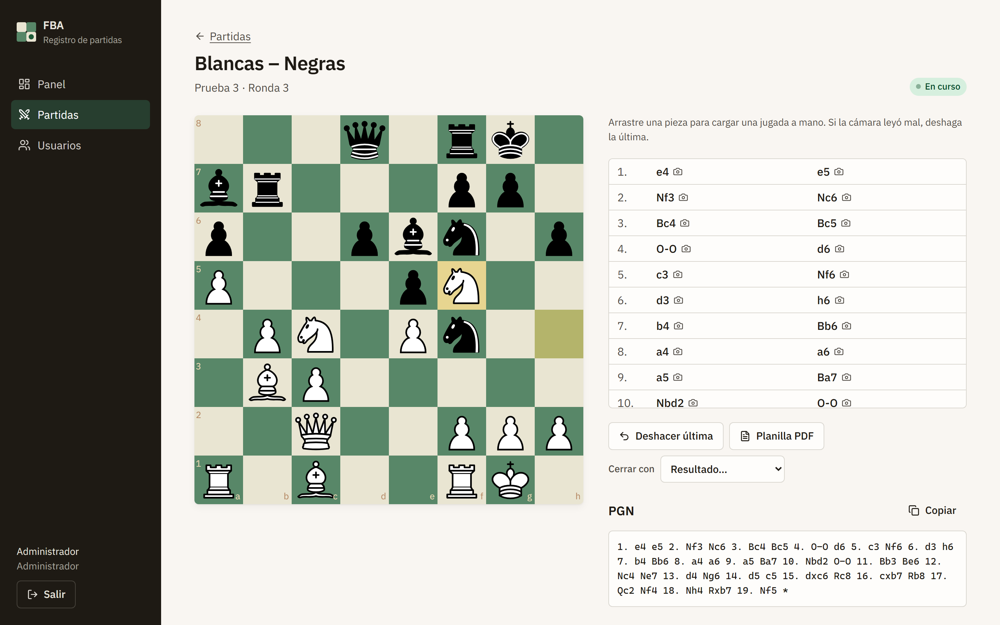

# Sistema de registro de partidas de ajedrez con visión por computadora (FBA)

Proyecto de grado, Ingeniería de Sistemas (UTB).

Un árbitro apunta el teléfono al tablero; la app Android reconoce la jugada en el propio dispositivo y la envía a una API REST. El servidor valida que la jugada sea legal, la guarda y la muestra en vivo en un panel web, donde también se gestionan usuarios por rol y se descargan reportes.



| Carpeta | Contenido |
|---|---|
| `backend/` | API REST Spring Boot 3.5 empaquetada como `.war` para WildFly 41. JWT, Swagger/OpenAPI, Flyway, logs SLF4J, reportes PDF (OpenPDF) y Excel (Apache POI). |
| `web/` | Panel React + Vite: login, panel en vivo, partidas con tablero, CRUD de usuarios. |
| `android/` | App Kotlin con CameraX y OpenCV. Se compila desde la terminal, sin Android Studio. |
| `docs/` | UML: [casos de uso](docs/casos-de-uso.md), [clases](docs/clases.md), [entidad-relación](docs/er.md). |
| `tasks/` | Plan y tareas por sprint. |

## Capturas

| App Android: tablero detectado solo | Panel web: partida registrada por la cámara |
|---|---|
|  |  |

Más capturas y reportes de ejemplo (PDF y Excel) en [`docs/capturas`](docs/capturas).

## Cómo se reconoce la jugada

En lugar de clasificar cada pieza (lento y frágil), la app compara fotos y razona con las reglas del ajedrez. Funciona con un tablero estándar cualquiera, sin marcadores, y con el celular inclinado (no hace falta ponerlo encima del tablero).

1. **Ubica el tablero solo**, en la posición inicial:
   - busca el contorno exterior del tablero (el cuadrilátero convexo más grande) y lo endereza con una homografía;
   - dentro, encuentra el ancho del marco a cada lado buscando dónde 9 líneas igualmente espaciadas calzan con los bordes de las casillas;
   - decide la orientación con las piezas: las blancas están del lado de las piezas claras y la columna «a» sale del color de las casillas (a1 es oscura).
2. **Fija enfoque y exposición** de la cámara para que no cambien entre fotos.
3. Después de cada jugada **compara cada casilla con la foto anterior**. Solo mide el centro de la casilla, corrido hacia la cámara, que es donde apoya la base de la pieza: con la cámara inclinada las piezas se recuestan y tapan los bordes de las casillas vecinas.
4. **Elige entre las jugadas legales** la que mejor explica los cambios (incluye enroque, captura al paso y coronación). La confianza se mide comparando la ventaja de la mejor jugada con el ruido de la cámara; si es baja, muestra las opciones en notación algebraica para que el árbitro elija.
5. Envía la jugada en notación UCI (`e2e4`) con su confianza. El servidor la vuelve a validar con las reglas.

Si la cámara se equivoca, el árbitro deshace la última jugada o la carga a mano. Si la detección automática falla, se calibra tocando las 4 esquinas.

En la prueba con un tablero plegable real, la app registró sola una partida de 37 jugadas (enroques, capturas y una captura al paso incluidas) sin correcciones.

## Ejecutar con Docker Compose

Requisitos: Docker Desktop.

```powershell
copy .env.example .env
docker compose up --build
```

- API: http://localhost:8080/ajedrez/api/health
- Swagger UI: http://localhost:8080/ajedrez/swagger-ui.html
- MySQL queda expuesto en el puerto 3307 del equipo.

Al arrancar con la base vacía se crea el administrador definido en `.env` (`ADMIN_EMAIL` / `ADMIN_PASSWORD`).

## Ejecutar sin Docker (desarrollo)

Requisitos: JDK 21 o superior, Maven, Node 20+, un MySQL o MariaDB local y WildFly 41.

```powershell
cd backend
mvn package
copy target\ajedrez.war C:\wildfly\standalone\deployments\
```

Las credenciales de la base se pasan con variables de entorno antes de iniciar WildFly (`DB_URL`, `DB_USER`, `DB_PASSWORD`, `JWT_SECRET`).

Panel web:

```powershell
cd web
npm install
npm run dev
```

Abrir http://localhost:5173. Vite reenvía `/ajedrez` al WildFly local.

## App Android (sin Android Studio)

Requisitos: JDK 17 o superior y las herramientas de línea de comandos del SDK de Android con las licencias aceptadas (`sdkmanager --licenses`). Crear `android/local.properties` con la ruta del SDK, por ejemplo `sdk.dir=C\:/Users/USUARIO/Android/Sdk`.

```powershell
cd android
.\gradlew.bat testDebugUnitTest assembleDebug
```

Con el celular conectado por USB y la depuración USB activada:

```powershell
adb install -r app\build\outputs\apk\debug\app-debug.apk
```

El APK ya compilado está en la sección **Releases** del repositorio.

**Uso:** crear la partida en el panel web, entrar a ella en la app con el tablero en la posición inicial y el celular fijo (puede estar inclinado). La cuadrícula verde aparece sola. Después de cada jugada, tocar «Registrar jugada».
- Pulsación larga en «Registrar jugada»: elegir la jugada de una lista.
- «Deshacer»: corrige la última jugada.
- Toque en «Calibrar»: calibración manual (esquinas a8, h8, h1, a1). Pulsación larga en «Calibrar»: vuelve a buscar el tablero solo.

### Conectar el celular con el servidor

**Por cable USB (lo más simple):** con la depuración USB activada, `adb reverse tcp:8080 tcp:8080` y en la app el servidor es `http://localhost:8080/ajedrez`.

**Por Wi-Fi (demo sin cable):**
1. Celular y PC en la misma red Wi-Fi (sirve el punto de acceso del propio celular).
2. Ver la IP del PC con `ipconfig` (por ejemplo `192.168.1.2`).
3. Permitir el puerto 8080 en el firewall de Windows (una vez, en PowerShell como administrador):
   ```powershell
   New-NetFirewallRule -DisplayName "Ajedrez API 8080" -Direction Inbound -Protocol TCP -LocalPort 8080 -Action Allow -Profile Private
   ```
4. En la app, el servidor es `http://IP-DEL-PC:8080/ajedrez`. Para comprobarlo, abrir `http://IP-DEL-PC:8080/ajedrez/api/health` en el navegador del celular: debe decir `{"estado":"ok"}`.

La red Wi-Fi debe estar marcada como «Privada» en Windows; en redes públicas (como la de la universidad) conviene usar el punto de acceso del celular.

## Pruebas

```powershell
cd backend
mvn test
```

`FlujoApiTest` recorre el flujo completo contra una base H2 en memoria: login, permisos por rol, creación de partida, jugadas legales e ilegales, mate y cierre automático, deshacer, panel y reportes.

## API principal

| Método | Ruta | Rol |
|---|---|---|
| POST | `/api/auth/login` | público |
| GET | `/api/partidas`, `/api/partidas/{id}` | cualquiera autenticado |
| POST | `/api/partidas` | ADMIN, ARBITRO |
| POST | `/api/partidas/{id}/jugadas` | ADMIN, ARBITRO |
| DELETE | `/api/partidas/{id}/jugadas/ultima` | ADMIN, ARBITRO |
| PATCH | `/api/partidas/{id}/resultado` | ADMIN, ARBITRO |
| GET/POST/PUT/DELETE | `/api/usuarios` | ADMIN |
| GET | `/api/dashboard` | cualquiera autenticado |
| GET | `/api/reportes/partidas.pdf`, `.xlsx`, `/api/reportes/partidas/{id}.pdf` | ADMIN, ARBITRO |

La documentación completa está en Swagger UI.
