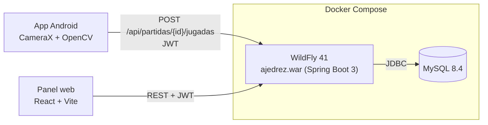

# Sistema de registro de partidas de ajedrez con visión por computadora (FBA)

Proyecto de grado, Ingeniería de Sistemas (UTB).

Un árbitro apunta el teléfono al tablero; la app Android reconoce la jugada en el propio dispositivo y la envía a una API REST. El servidor valida que la jugada sea legal, la guarda y la muestra en vivo en un panel web, donde también se gestionan usuarios por rol y se descargan reportes.



| Carpeta | Contenido |
|---|---|
| `backend/` | API REST Spring Boot 3.5 empaquetada como `.war` para WildFly 41. JWT, Swagger/OpenAPI, Flyway, logs SLF4J, reportes PDF (OpenPDF) y Excel (Apache POI). |
| `web/` | Panel React + Vite: login, panel en vivo, partidas con tablero, CRUD de usuarios. |
| `android/` | App Kotlin con CameraX y OpenCV (en construcción). |
| `docs/` | UML: [casos de uso](docs/casos-de-uso.md), [clases](docs/clases.md), [entidad-relación](docs/er.md). |
| `tasks/` | Plan y tareas por sprint. |

## Cómo se reconoce la jugada

En lugar de clasificar cada pieza (lento y frágil), la app:

1. Detecta las cuatro esquinas del tablero y lo endereza con una homografía (OpenCV).
2. Divide la imagen en 64 casillas y mide cuáles están ocupadas y de qué color es la pieza.
3. Compara con la posición anterior y elige, entre las jugadas legales, la que explica ese cambio.
4. Envía la jugada en notación UCI (`e2e4`) con su nivel de confianza. El servidor la vuelve a validar.

Si la cámara se equivoca, el árbitro deshace la última jugada o la carga a mano.

## Ejecutar con Docker Compose

Requisitos: Docker Desktop.

```powershell
copy .env.example .env
docker compose up --build
```

- API: http://localhost:8080/ajedrez/api/health
- Swagger UI: http://localhost:8080/ajedrez/swagger-ui.html
- MySQL queda expuesto en el puerto 3307 del equipo.

Al arrancar con la base vacía se crea el administrador definido en `.env` (`ADMIN_EMAIL` / `ADMIN_PASSWORD`).

## Ejecutar sin Docker (desarrollo)

Requisitos: JDK 21 o superior, Maven, Node 20+, un MySQL o MariaDB local y WildFly 41.

```powershell
cd backend
mvn package
copy target\ajedrez.war C:\wildfly\standalone\deployments\
```

Las credenciales de la base se pasan con variables de entorno antes de iniciar WildFly (`DB_URL`, `DB_USER`, `DB_PASSWORD`, `JWT_SECRET`).

Panel web:

```powershell
cd web
npm install
npm run dev
```

Abrir http://localhost:5173. Vite reenvía `/ajedrez` al WildFly local.

## Pruebas

```powershell
cd backend
mvn test
```

`FlujoApiTest` recorre el flujo completo contra una base H2 en memoria: login, permisos por rol, creación de partida, jugadas legales e ilegales, mate y cierre automático, deshacer, panel y reportes.

## API principal

| Método | Ruta | Rol |
|---|---|---|
| POST | `/api/auth/login` | público |
| GET | `/api/partidas`, `/api/partidas/{id}` | cualquiera autenticado |
| POST | `/api/partidas` | ADMIN, ARBITRO |
| POST | `/api/partidas/{id}/jugadas` | ADMIN, ARBITRO |
| DELETE | `/api/partidas/{id}/jugadas/ultima` | ADMIN, ARBITRO |
| PATCH | `/api/partidas/{id}/resultado` | ADMIN, ARBITRO |
| GET/POST/PUT/DELETE | `/api/usuarios` | ADMIN |
| GET | `/api/dashboard` | cualquiera autenticado |
| GET | `/api/reportes/partidas.pdf`, `.xlsx`, `/api/reportes/partidas/{id}.pdf` | ADMIN, ARBITRO |

La documentación completa está en Swagger UI.
