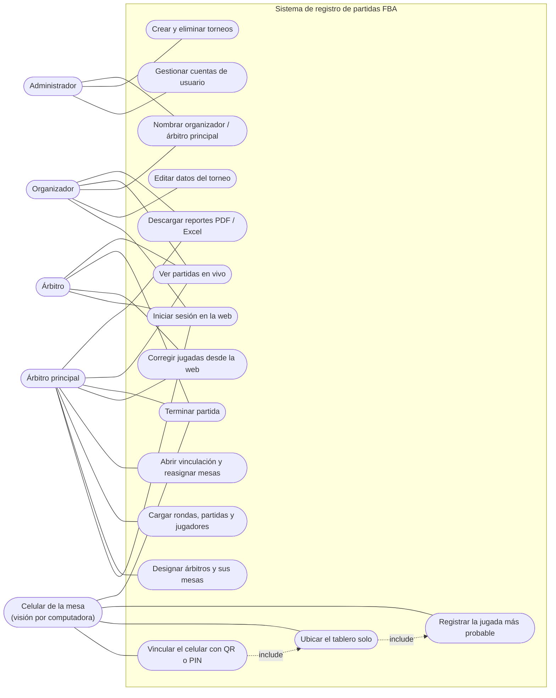

# Diagrama de casos de uso

GitHub dibuja este diagrama directamente (Mermaid). Los roles de organizador y árbitros son **por torneo**: una misma persona puede tener roles distintos en torneos distintos. El celular de cada mesa no tiene cuenta: se vincula con el QR o el PIN del torneo.

| Caso de uso | Actor | Descripción breve |
|---|---|---|
| Gestionar cuentas | Administrador | Crear, editar, desactivar y eliminar usuarios (rol global ADMIN o USUARIO). |
| Crear y eliminar torneos | Administrador | Solo el administrador; un torneo con partidas no se puede eliminar. |
| Editar datos del torneo | Organizador | Nombre, categoría, ciudad y fecha. Ve todas las partidas, pero no corrige ni finaliza. |
| Nombrar organizador / árbitro principal | Administrador, Organizador | El administrador nombra organizadores; el organizador, al árbitro principal. |
| Designar árbitros y sus mesas | Árbitro principal | Elige árbitros entre los usuarios y a qué mesas atiende cada uno (todas por defecto). |
| Cargar rondas, partidas y jugadores | Árbitro principal | Cada partida va a una mesa; el celular de esa mesa la toma solo. |
| Abrir vinculación y reasignar mesas | Árbitro principal | Un QR + PIN por torneo, válido 15 minutos. Cada celular recibe un código (C-07) y la siguiente mesa libre; el árbitro principal la cambia si hace falta. |
| Vincular el celular | Celular | Escanea el QR o escribe el PIN; no hay inicio de sesión en la app. |
| Ubicar el tablero solo | Celular | En la posición inicial detecta el contorno del tablero, el marco y la orientación. |
| Registrar la jugada más probable | Celular | Cuando la imagen queda quieta, deduce la jugada legal que explica los cambios y la registra con su confianza. Las dudosas se marcan en la web. |
| Corregir jugadas | Árbitro, Árbitro principal | Toca la jugada en la web y arrastra la pieza correcta; las posteriores se descartan y la cámara sigue desde ahí. |
| Terminar partida | Árbitro, Árbitro principal, Celular | Resultado 1-0, 0-1 o ½-½ con confirmación. Mate y ahogado se cierran solos. |
| Descargar reportes | Roles del torneo | Listado del torneo en PDF o Excel y planilla PDF de cada partida. |
