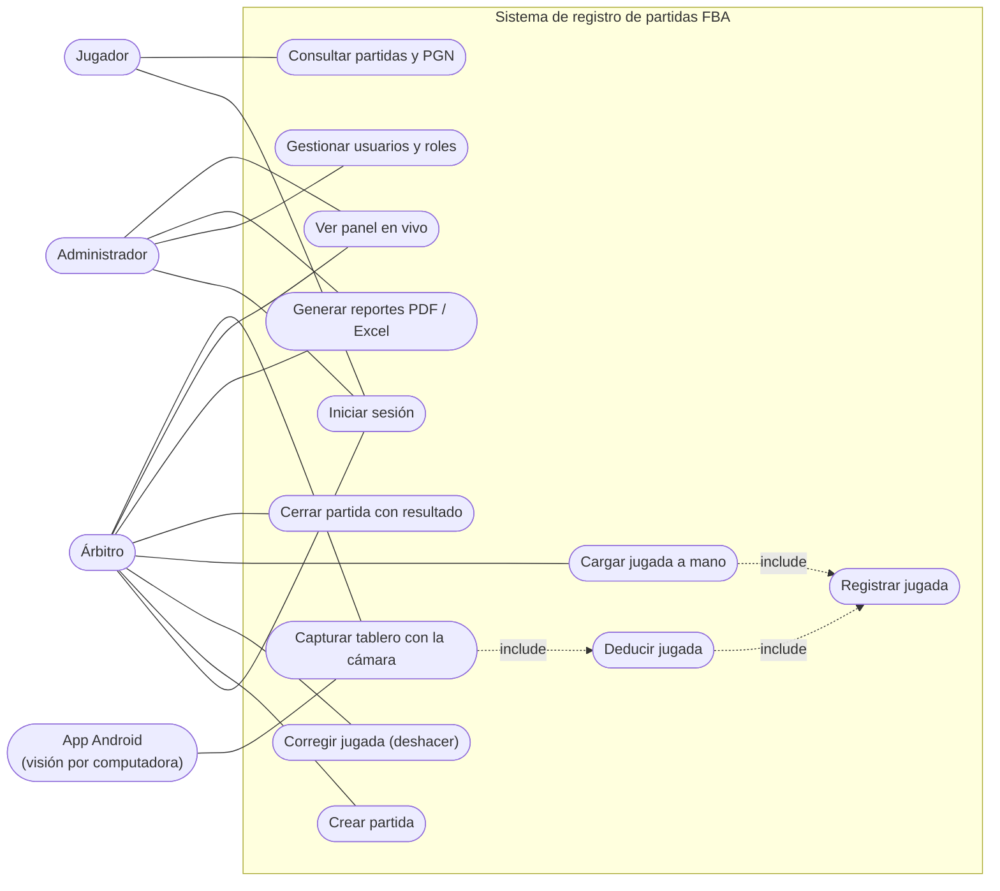

# Diagrama de casos de uso

GitHub dibuja este diagrama directamente (Mermaid). Los actores están a la izquierda; el sistema agrupa los casos de uso.

| Caso de uso | Actor | Descripción breve |
|---|---|---|
| Iniciar sesión | Todos | Email y contraseña; el sistema devuelve un token JWT con el rol. |
| Gestionar usuarios y roles | Administrador | Crear, editar, desactivar y eliminar usuarios. No se puede quitar al último administrador. |
| Crear partida | Árbitro, Administrador | Registra jugadores, torneo y ronda. La partida empieza en la posición inicial. |
| Capturar tablero / Deducir jugada | Árbitro con la app Android | La app detecta el tablero, compara la ocupación de casillas con la posición anterior y elige la jugada legal que la explica. |
| Registrar jugada | Sistema | El servidor valida la jugada contra la posición actual, calcula la notación SAN y detecta mate o tablas. |
| Corregir jugada | Árbitro | Deshace la última jugada si la cámara se equivocó. |
| Cargar jugada a mano | Árbitro | Arrastrando la pieza en el tablero de la web. |
| Cerrar partida | Árbitro | 1-0, 0-1 o ½-½ cuando hay abandono o acuerdo. |
| Consultar partidas | Todos | Lista, tablero, jugadas y PGN. |
| Generar reportes | Árbitro, Administrador | Listado en PDF o Excel y planilla PDF de cada partida. |
