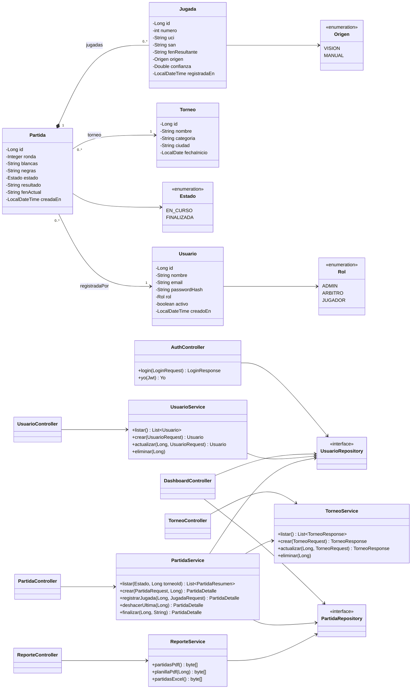
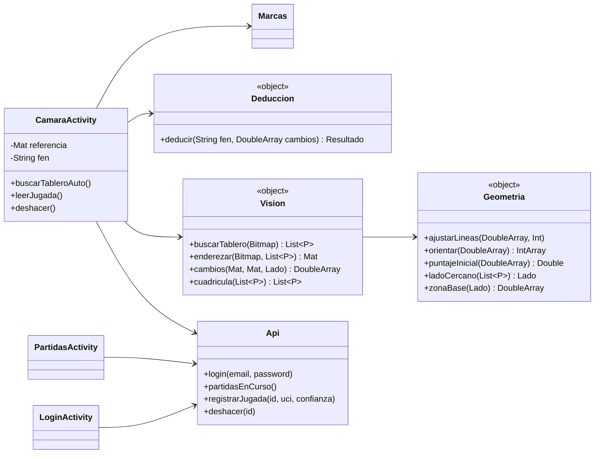

# Diagrama de clases (backend)

Clases principales del paquete `bo.utb.ajedrez`. Los controladores REST dependen de servicios; los servicios usan repositorios Spring Data JPA.

## App Android

`Vision` usa OpenCV; `Geometria` y `Deduccion` son lógica pura con tests unitarios (19 tests, dos con datos medidos en una prueba real).

## Validación de jugadas en el servidor

`PartidaService.registrarJugada` usa la librería chesslib para validar que la jugada UCI sea legal en `fenActual`, obtener la notación SAN y detectar mate, ahogado o material insuficiente.
