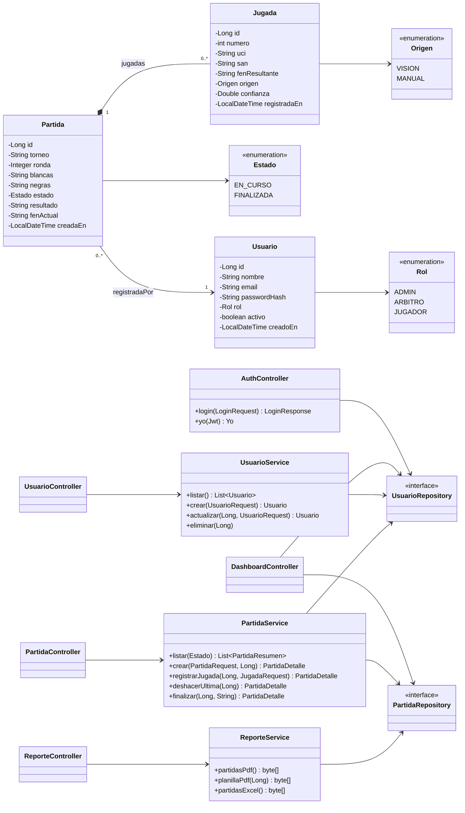

# Diagrama de clases (backend)

Clases principales del paquete `bo.utb.ajedrez`. Los controladores REST dependen de servicios; los servicios usan repositorios Spring Data JPA.

`PartidaService.registrarJugada` usa la librería chesslib para validar que la jugada UCI sea legal en `fenActual`, obtener la notación SAN y detectar mate, ahogado o material insuficiente.
