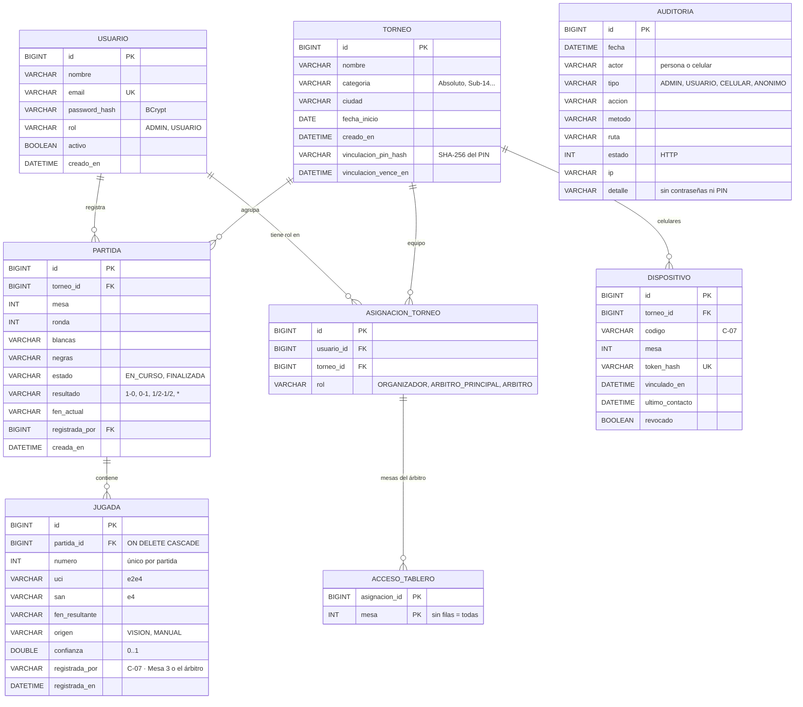

# Diagrama entidad-relación (MySQL)

El esquema lo crea Flyway con `backend/src/main/resources/db/migration/` (V1: esquema inicial; V2: torneos; V3: roles por torneo y celulares; V4: auditoría; con migración de los datos existentes). La tabla AUDITORIA no tiene claves foráneas a propósito: el registro se conserva aunque se borre lo que describe..

